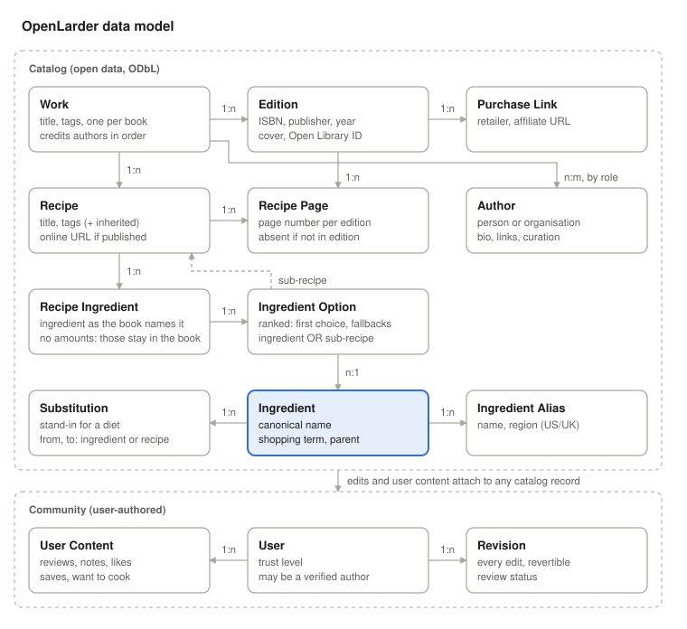

# OpenLarder: Scope

Nov 6, 2026 · @Raymond Tetzloff

This is a living document. A decision goes in here as part of the change that makes it, with who decided and when. A decision that gets overturned stays, marked as superseded, with a note on what changed.

## Overview

A free, public, crowdsourced index of recipes in cookbooks and other sources: what's in each book, on which page of which edition, with normalized ingredients, links to buy the book or the ingredients, and an open API. Name: OpenLarder (openlarder.com and openlarder.org). Hosting: self-hosted on Coolify to start.

**Positioning vs Eat Your Books.** EYB does the core indexing well but is a paid membership with a closed catalog. This site competes on four things EYB doesn't offer together:

- Free to use, funded by affiliate links
- Ingredient shopping links (book to recipe to cart)
- Open data and a public API
- A modern, fast, mobile-first experience

**Principles**

- Index, don't reproduce: never store a book's instructions or headnotes
- Ingredients are first-class data, normalized from day one
- Every contribution is versioned and reversible
- The catalog is a public good; the license guarantees it stays open

## Business model

Free for everyone; revenue comes from affiliate commissions on books and groceries. No paywall, no premium tier at launch.

| Stream | Partners | Notes |
| --- | --- | --- |
| Cookbook purchases | Bookshop.org, Amazon Associates | Link per Edition (ISBN). Amazon closes accounts without 3 qualifying sales in the first 180 days, so add it once there's traffic. Bookshop.org first. |
| Ingredient purchases | Instacart (or similar) | Recipe page builds a cart from its normalized ingredients. Confirm current affiliate/API terms. |
| Open API | None at launch | Free with rate limits. Possible paid tier for heavy commercial use later. |

Hosting cost should stay low enough that affiliate revenue only needs to cover infrastructure early on.

**Tracking and disclosure** (talked through by Ray and Claude, 2026-11-07; recorded as the plan, not yet built)

- **Affiliate links say so.** Each set of buy links carries a short disclosure next to it that OpenLarder earns from purchases, as the FTC requires, plus the wording each programme demands ("As an Amazon Associate I earn from qualifying purchases"). The privacy policy says the links go to outside shops, which track the purchase under their own policies. Both arrive in the same PR as the links.
- **OpenLarder counts its own clicks.** Buy links go through `/go/<link-id>`, which records the link, the time and the page it was clicked on, then redirects with the affiliate ID. It records no user, IP address or cookie, and skips known bots. The shops' reports show sales but not which OpenLarder page sent them; this does. One small table of clicks on Purchase Link, and one line in the privacy policy.
- **Analytics: Google Analytics and Tag Manager are likely, not decided.** Whatever is chosen arrives with its privacy-policy wording and, for anything that sets cookies or recognises a visitor again, a consent banner for EU and UK visitors. Cookie-free aggregate counters (Plausible, Umami) need no banner and still need disclosing; fingerprinting does not escape consent and is not used.
- **Google Ads, someday.** It brings advertising cookies to OpenLarder's own pages, so it brings the banner and fuller disclosure with it.
- **Sign-in cookies need no consent**, being strictly necessary for something the visitor asked for. They are listed on the privacy page.

## Content rules

The site stores facts about recipes, never the recipes themselves. Book text stays in the book. OpenLarder is a cookbook reference: it says which book and page a recipe is on and what goes in it, so you can find it, not how to make it. *Ray, 2026-11-07.*

| Stored | Not stored |
| --- | --- |
| Recipe title, page number per edition | Instructions or method |
| Ingredients by name, without amounts (normalized) | Headnotes, intros, the book's own author bio |
| | Amounts, units and preparation ("200g", "diced") |
| Tags: course, cuisine, diet, technique | Photos from the book |
| Link to the recipe if the publisher posted it online | Scanned pages |

*Narrowed 2026-11-06: "not stored" used to say "author descriptions" with no qualifier. Bios written by contributors or by the author are now allowed (see Author pages). The bio printed in the book still isn't stored.*

**User content (allowed, user-authored only)**

- Descriptions in the user's own words
- Author bios in the contributor's own words (see Author pages)
- Reviews and ratings
- Likes, saves, "want to cook" lists
- Cooking notes and substitutions

**Risk:** users will paste headnotes or instructions from books. Moderation and a report button handle this; a similarity check against known book text is a later option.

## Entry rules

What goes into a recipe's ingredient list, and what is left out. These are the rules the household index was built with, adopted for the whole catalog. *Adopted by Ray, 2026-11-07.* They are what the form asks for, what the bulk import checks, and what the detector (issue #26) checks.

**Leave out**

- Quantities, measurements and directions: "salt", never "1 tsp salt".
- Items marked "optional" or "if desired".
- Salt, pepper, sugar and water, except for:
  - special kinds: non-black peppers, whole peppercorns, special salts, and sugars other than white granulated;
  - a recipe where one of them is the whole point, such as a flavoured salt;
  - sugar in candies, jams and jellies, or wherever a large amount is the point.
- Prep and direction words ("chopped", "sliced", "peeled"), except that canned or frozen is kept (see below).
- Brands, unless the brand matters.
- A whole recipe whose ingredients are a free choice ("Vegetable Rice", "Build-Your-Own Salad"). With that many interchangeable options it is no help to someone searching by ingredient.

**Write it like this**

- Each ingredient once per recipe, even when the recipe uses it twice.
- Minimal descriptors: "milk", not "whole milk", unless whole milk matters.
- Singular where it reads naturally ("egg"), plural where nobody would use one ("blueberries").
- Canned or frozen named when the fresh food also exists: "crushed tomato (canned)". This is the form that lives in the canonical ingredient rather than a column (migration 0011).
- When a recipe offers a choice, as many do: list the options in order, as ranked fallbacks ("grapeseed oil or olive oil"); or name the kind of thing ("fat", "meat") when the book says any will do; or, where the method makes it clear, the one it actually uses. Which one is a judgement call per recipe. A kind of thing is a canonical ingredient with children in the hierarchy (fat → butter, oil).

**Known aliases**, seeded with the ingredients:

- Chinese cooking wine = Shaoxing wine
- Won bok cabbage = napa cabbage

**Still to settle** (from the same rules, under "looking at altering or fixing"):

- Molasses: say "blackstrap" wherever it is needed.
- Ground versus whole spices, and fresh versus dried.
- Rice: name the grain where it definitely matters (sushi, risotto).
- Yogurt: say "Greek" where it is.

**The detector** (built, issue #26, migration 0017). Each line is checked against these rules. The form shows what it finds under the ingredients as they're typed, with a one-click fix ("2 onions, finely diced" becomes "onions"; "Salt" is removed), and never blocks saving, since a line can be an exception. An import keeps every line and flags what it finds: "Usually left out" for salt, pepper, sugar and water and for anything optional, and "Amount or prep in a line" with the suggested bare ingredient. *Flagging the stop list on import too is Ray's call, 2026-11-08*; on the household index that is 420 lines in 396 recipes, and nothing else fires. The rules are narrow because a book's names look like amounts and prep ("Half-and-Half", "160 Bloom Gelatin", "Diced Tomato (Can)", "Large Shrimp"): prep counts only after a comma or behind an adverb, and a size only after a count. Brands aren't detected, which would need a list. A line repeating an earlier one, plurals and spelling aside ("Egg", "2 eggs"), is pointed out in the form; saving already drops exact repeats.

## Data model

A Recipe belongs to one Source: a book, a website, a magazine or a newspaper so far. Where it is lives on Recipe Location, which points to exactly one part of its own source: for a book one row per Edition it appears in with its page, so one recipe entry covers every printing; for a website its Web Page, by address; for a magazine or newspaper its Issue, with a page. *Migration 0019 renamed Work to Source and Recipe Page to Recipe Location, ahead of other kinds of source (Ray, 2026-11-08); each kind keeps its own parts in its own table, editions for books.*

Ingredient lines name the ingredient as the book does, without an amount ("caster sugar", not "200g caster sugar"), and each of a line's options points to one canonical Ingredient, which carries the shopping term and a parent for broader search. On the book page, editions show as tabs or subpages with their own page numbers and purchase links.

Tags set on a Source (such as a diet focus like Gluten-Free) are inherited by every recipe in it, in addition to any tags set on the recipe itself.

A Recipe Ingredient holds one or more ranked Ingredient Options. Each option points to either a canonical Ingredient or another Recipe (a sub-recipe, such as a flour blend used throughout a gluten-free book). Sub-recipe links let users jump to the component recipe and its page, and shopping lists expand them into their own ingredients.

Most lines have a single option. A line the book prints as "grapeseed oil or olive oil" has two: grapeseed oil first, then olive oil as the fallback. "Cheddar or any cheese" works the same way, even though cheddar sits under cheese in the hierarchy. Shopping lists use the first option. *Decided by Ray, 2026-11-06, because books print lines like this often.*

*Superseded 2026-11-07: "When the book gives each option its own quantity, the option carries it." No amounts are stored at all (migration 0011, Ray: "it's literally not a recipe site, it's cookbook reference").*

*Superseded 2026-11-06: a Recipe Ingredient used to point at one target directly. Migration 0002 moved each line's target onto a single first-choice option.*

**Substitutions**

A Substitution says one thing can stand in for another: an ingredient or a recipe on either side, for a stated reason, usually a diet ("vegan butter for butter, dairy-free"). It can link two flour blends from different books. It is catalog data under the ODbL, separate from the free-text cooking notes users write. Each substitution records where it came from: printed in a book (edition and page), or contributed. *Decided by Ray, 2026-11-06: most of the books in the first import are allergen-free in some way, so this gets heavy use.*

Built in migration 0004. A substitution goes one way: the reverse is its own entry, because it often doesn't hold. Its source is an edition rather than a work, because pages differ between editions. *Narrowed by Claude while building it; this used to say "work and page".* How much to use ("3 tablespoons aquafaba per egg") goes in an optional free-text note (migration 0005), not structured data. *Decided by Ray, 2026-11-06: an amount can be noted, but substitutions are primarily about what, not how much.*

**Allergen data**

Ingredients carry allergen data (contains dairy, gluten, egg). This lets the site offer substitutions for a diet automatically, not only where someone has entered one. *Decided by Ray, 2026-11-06, on the condition that it is presented as crowdsourced information.* It can come from contributors or from the ingredient data source, where that source records it. *Ray, 2026-11-07.*

- Wherever allergen data or a diet-based suggestion appears, a notice says it is crowdsourced and unverified, and that it is not a guarantee a recipe is safe for anyone.
- The site never labels a recipe "safe for" an allergy. It can say what the catalog records about the ingredients, and nothing more.
- Allergen data describes an ingredient in general, not any product. Oats may or may not be processed alongside wheat, and one brand's stock may contain milk when another's doesn't. The notice says so.
- The wording of the notice is written with the feature and reviewed by a lawyer along with the content rules.

## Author pages

Every author gets a page: a bio, links, their books, the people they've written with, and their top-ranked recipes. Once verified, an author can curate their own page. *Decided by Ray, 2026-11-06.*

**Authors and credits**

An Author is a person or an organisation (America's Test Kitchen, The Culinary Institute of America). A Source credits its authors in order, each with a role: author, editor, and so on. The credit keeps the name as the book prints it ("Sarah Ballantyne, PhD", "Adam Rapoport (Editor)") and points to one Author, the same way an ingredient line keeps its original text and points to one Ingredient. This replaces the plain list of names on Work, now Source (migration 0003). Authors link to Open Library and Wikidata where those records exist.

Roles are author, editor, contributor, photographer, illustrator and translator. *Chosen by Claude, 2026-11-06, as the roles cookbook covers and title pages commonly print. A new role is a one-line change to a CHECK constraint.*

**What an author page shows**

- A bio, from up to three sources: written by contributors in their own words, written by the author once verified, and short facts imported from Wikidata (born, nationality, website). Never copied from a book jacket, and never Wikipedia prose: Wikipedia is CC BY-SA, which doesn't fit the ODbL. Wikidata is CC0, so its facts do. *Sources decided by Ray, 2026-11-06.*
- Links: the author's website, social accounts, and other official presences.
- Books, linking to each book's page, and the co-authors credited with them.
- Top-ranked recipes, once ratings exist (Phase 2). Until then, the section is left off rather than filled with a substitute ranking.

**Verified authors**

A verified author is linked to a user account and can change their page's presentation: bio, photo, links, and which books and recipes are featured. They cannot hide or remove reviews or ratings. Their edits to catalog facts about their own books (pages, ingredients) go through review like anyone else's. *Decided by Ray, 2026-11-06.*

How an author proves who they are is not designed yet.

**Built** (2026-11-08): each author has a page with their books (and their role, when it isn't author, and the name the book prints when it differs), the people credited with them on those books, most shared first, their links and Open Library. Names on a book page link there, and there's an authors list. An admin fixes an author's own name and kind on the page, Open Library authors included, since its names come as it files them ("Moore, Russell (Chef)"); editing a book changes only how that book prints the name. Links must be http or https. Wikidata facts, bios and photos wait (TODO.md).

Two records of one person are merged on the author's page, which lists other authors whose names compare the same (case, accents, punctuation and "Last, First" aside): credits, links and outside records move to the one kept, and each source still prints its own name. A typed name matches the one author with the same name key, Open Library's included; when several share it, a new record is made for merging by hand. *Ray, 2026-11-08, after Katarina Cermelj and Jennifer McLagan each came out as two; until then Open Library's authors were left out of matching.*

## Ingredient normalization

Every ingredient line resolves to one canonical ingredient. Search, shopping, and the API all depend on this.

*Superseded 2026-11-07: "plus optional form, prep, and quantity". Amounts and prep are the recipe's, which stays in the book; form is part of what the ingredient is ("canned tomatoes"), so it lives in the canonical ingredient. Migration 0011 dropped the columns. Dropping form and prep as well as amounts is Claude's reading of Ray's decision.*

**Structure**

- **Canonical ingredient:** one record per real thing ("green onion")
- **Aliases:** names that resolve to it ("scallion", "spring onion"), with optional region (US/UK/AU)
- **Hierarchy:** parent links for broad search ("aged cheddar" → cheddar → cheese)
- **Form:** part of the canonical ingredient ("canned tomatoes", "dried chickpeas"), since it changes what you buy. Prep ("diced", "toasted") is not stored.
- **Shopping term:** what to search for at the grocer, which can differ from the name

**Seeding**

Start from an existing dataset rather than an empty table.

- **Base: USDA FoodData Central.** Public domain (CC0), so it fits the ODbL with no conditions. It is seeded from the bulk download (CSV or JSON, updated each April and October), not the API, so the API's default of 1,000 requests an hour only limits later lookups. Branded products are left out: the catalog wants "butter", not one company's butter.
- **Backup: Wikidata.** Also CC0. It fills what FoodData Central lacks: other names for an ingredient (aliases, including regional ones) and "is a kind of" links for the hierarchy (cheddar under cheese).
- **FoodOn: not used for now.** It is CC BY 4.0, which carries an attribution condition, and its strength is the same kind of hierarchy Wikidata provides.

*Decided by Ray, 2026-11-06: FoodData Central as the base and Wikidata as the backup. Leaving FoodOn out, and the reasons for it, are Claude's recommendation; Ray was unsure about FoodOn.*

*Revised by Ray, 2026-11-07: canonical names come from the household index, not from FoodData Central.* FDC's names read like "Onions, raw" and "Cheese, cheddar, sharp", while the index's already follow the entry rules ("Yellow Onion", "Fresh Ginger"). The index has 10,540 distinct names across 140,645 lines; the 1,000 most used cover 85% of uses. Canonical ingredients start from those names, with obvious variants merged, and FoodData Central and Wikidata records are linked to them afterwards for allergens, nutrition and aliases, without taking over the names.

**Matching flow**

1. Contributor types the ingredient as the book names it, without the amount
2. Fuzzy match suggests canonical ingredients as they type
3. Contributor picks one, or flags it as new
4. New ingredients go to a moderation queue to be approved, merged, or mapped as an alias

The original text line is kept alongside the match, so mappings can be corrected later without re-entry.

**Canonical ingredients** (built, migration 0015). Every option that isn't a page reference is matched to a canonical ingredient by a key that ignores case, plurals, hyphens and punctuation ("Cinnamon Sticks" and "cinnamon stick" are one; "Long-Grain Rice" and "Long Grain Rice" are one). Accents count, so "Rosé" and "Rose" stay two: merging too much is harder to undo than merging too little. An option no ingredient has the key of becomes a new ingredient, named with the spelling its book uses most; until review exists that publishes at once, like the rest of an admin's entries, and merging is how a wrong one is fixed. Over the household index this gives about 6,900 ingredients from 7,219 spellings. Steps 2 to 4 of the matching flow above (suggestions as someone types, flagging something new, the moderation queue) wait for contributions beyond admins. The Ingredients page lists them by how many recipes use each, narrowed by name as someone types, and each ingredient's page lists its recipes with book and page: the first form of search by ingredient.

**Fixing ingredients** (built, migration 0016). An admin can rename an ingredient, merge it into another, or delete one nothing uses, from its page. Renaming keeps the old name as an alias when its key changes, and merging keeps the merged name and its aliases, so lines written those ways go on matching where they were moved; removing an alias stops that. Aliases match by the same key as names, one ingredient per key. Only unmarked aliases match lines, since a book's region isn't known; regional ones ("spring onion", UK) are for display and search. Renaming onto a name another ingredient has, or another name for one, is refused with an offer to merge into it. Merging also moves substitutions (dropping one that would swap an ingredient for itself, or that the other has already) and hands over children in the hierarchy. An ingredient a line was matched to wrongly ("Ham" from "Ham or Chicken Stock") is fixed on the recipe, by correcting the line, after which the stray ingredient can be deleted. *Keeping old names as aliases is Claude's choice, 2026-11-08.*

**Search by ingredients** (built). The Search page finds the recipes that use every one of up to ten ingredients, listed by book with their pages. Any option on a line counts ("Butter or Coconut Oil" is a recipe with coconut oil), and an ingredient takes in those under it in the hierarchy, so cheese finds a recipe with cheddar; an ingredient's own page stays exact. The chosen ingredients are kept in the address, so a search can be bookmarked or shared, and a link naming an ingredient since merged away searches without it and says so. An admin sets the hierarchy from an ingredient's page, putting it under another or another under it ("Fresh Ginger" and "Ground Ginger" under "Ginger"); a move that would make a loop is refused. The page shows what it comes under and what it includes, and counts the recipes using it or anything under it. A search can stay within one book, and a book's page lists the 30 ingredients its recipes use most, each opening that search in the book.

*Changed by Ray, 2026-11-08: "I have three cookbooks pulled out... I have these ingredients".* Ingredients now rank rather than filter: a recipe is found if you have any of its lines, and the more of the recipe you have, the higher it comes ("you have 5 of its 7"), with the lines it still needs listed. Books are type-to-find, and a search can take several (a recipe in any of them), since a list of every book won't scale.

**Options and recipe references** (built, migration 0014). Each line is read into its ranked options: split on "or", and on commas only in a list ending ", or" ("Dry Sherry, Hard Cider, or Dry White Wine"), since names carry commas of their own. An option citing a page ("Basic Cauli-Rice (p. 269)") is linked to the recipe it means in the same book: the recipe of that name on that page; else of that name on another page, flagged; else the one other recipe on that page, since a component is often printed inside the recipe that uses it ("Tomato Sauce (p. 114)" in the ravioli on page 114; *Ray, 2026-11-07*); else, on a page with several, the one whose title shares the most words with the name ("Chicken Stock (p. 475)" on a page of stocks); else nothing, flagged when the page has no recipe at all. A recipe page links its references and lists the recipes that use it. Over the household index this links 7,921 of 8,250 references (96%). A known limit: "Ham or Chicken Stock" splits into "Ham" and "Chicken Stock"; the line still displays as written, and matching options to canonical ingredients will need to catch a shared final word.

## Sign-in

OpenLarder signs people in through an identity broker, and talks to the broker with one OpenID Connect integration. The broker handles each provider, links one person's accounts across providers, and has an admin screen for adding providers. *Decided by Ray, 2026-11-06.*

- **Google and GitHub first**, more later. GitHub's sign-in is plain OAuth, not OpenID Connect: a site gets a token and asks GitHub's API who the user is. That is why a broker rather than generic OIDC in the app: the app would otherwise need separate code for GitHub.
- **Email accounts too**, for people who use neither Google nor GitHub. *Decided by Ray, 2026-11-06.*
- **Email accounts sign in by an emailed link, not a password**, and can add a passkey to skip the email. No passwords means none to leak, reuse or reset; with 30-day sessions, waiting for an email is rare. *Decided by Ray, 2026-11-06, superseding "by password or sign-in link".* A six-digit emailed code is acceptable too. *Ray, 2026-11-07.* Under Authentik the link lasted 15 minutes and could be reused within them; Authgear's limits are not yet checked (see Open decisions). All of this is broker configuration; OpenLarder's code is unchanged.
- **Authgear Cloud**, on its free plan, at `auth.openlarder.com` (a custom domain on top of `openlarder.authgear.cloud`). *Decided by Ray, 2026-11-07.* It does every method above, speaks standard OpenID Connect, and answers in about 0.2 s. Self-hosted Authgear needs about nine containers and recommends Kubernetes, so it waits until there is a reason for it; moving there later is a change of settings, not code. Passkeys are tied to the sign-in domain, which is why the custom domain went on before anyone added one: changing it later breaks every passkey.

*Superseded 2026-11-07: "Authentik first, Keycloak the fallback" (Ray, 2026-11-06). Authentik worked, but every request took 5–7× longer than on a modern core, because coolify-prod1's CPUs are 2014 Haswell Xeons (issue #18). Also weighed: ZITADEL, which cannot sign in by email alone; Keycloak, Ory and WorkOS, which lack an emailed link or need add-ons; Auth0 and Clerk, hosted but with more lock-in; SuperTokens, the most code; Supabase, whose passkeys are beta.*

*Superseded 2026-11-06: the stack table named "generic OIDC (e.g. Zitadel)". Zitadel was weighed and not chosen.*

**Built** (migration 0006). Signing in creates a user keyed by the broker's issuer and subject, so OpenLarder never learns which provider someone used. It stores no email address: nothing sends mail yet. *Chosen by Claude, 2026-11-06: keep personal data out until a feature needs it.* A session is a random token in an HttpOnly cookie, kept 30 days, with only its hash stored. It also keeps the ID token from sign-in, which Authentik needed before it would send someone back after signing out (migration 0007). Authgear does not require it but accepts it. Signing out ends the OpenLarder session, then sends the browser to the broker to end its session too, and back to the front page. *Superseded 2026-11-06: it first ended only the OpenLarder session, so the next sign-in went straight through. Ray asked for a real sign-out.*

**Display names** (migration 0008) are chosen in OpenLarder, because they are public: they appear beside contributions in the edit history, and a provider's name for someone is often their full legal name. A first sign-in asks for one, pre-filled with the provider's name if it would pass; that suggestion is deleted once a name is chosen, and signing in never overwrites a chosen name. Names are unique ignoring case, so an edit history can tell two contributors apart, as on OpenStreetMap and Wikipedia. *Decided by Ray, 2026-11-07.* They are 2 to 32 letters or numbers in any script, joined by single spaces, dots, dashes, underscores or apostrophes, normalised with NFKC so full-width and other compatibility forms compare equal. A few names that would read as speaking for the site (admin, moderator, openlarder, …) are reserved. *Rules and reserved list chosen by Claude, 2026-11-07.* Not caught: look-alike letters from different scripts, such as Cyrillic "а" for Latin "a"; that is moderation's.

*Superseded 2026-11-07: display names were the broker's, refreshed at each sign-in, with "OpenLarder user" for anyone the broker had no name for.*

Not built yet: trust levels, agreeing to the ODbL before the first contribution, and the Google, GitHub and email sign-up flows, which are configured in Authgear rather than here. Google sign-in stays in Google's testing mode until the privacy policy and terms are published (see Privacy and terms).

## Privacy and terms

`/privacy` and `/terms` on the site. OpenLarder is run by Ray personally, contact is privacy@openlarder.com, and the terms are under Wisconsin law. *Decided by Ray, 2026-11-07.*

Both pages are written from what the code actually does: what is stored, which services handle it, which cookies are set. They change in the same pull request as any change to those. They are not a template and not legal advice; the lawyer review planned for the content rules and the allergen notice covers them too.

## Contributions and moderation

Modeled on OpenStreetMap and Wikipedia: anyone can contribute, everything is versioned, and trust is earned.

**Until review exists, only admins add to the catalog**, and what they add publishes at once with no edit history. Building history before the catalog's structure settles would record a stream of structural churn as if it were edits. Review, edit history and the ODbL agreement arrive together, before anyone else can contribute. *Decided by Ray, 2026-11-07.* The first admin is set by hand in the database.

**Books come from Open Library.** Its catalog is public domain (CC0), so it fits the ODbL without conditions. Adding a book looks up its ISBN: the edition, its work, and the work's authors. A second ISBN of a book already here joins it as another edition, matched by Open Library's work ID, and authors are matched by Open Library's author ID. Open Library asks callers to identify themselves with a contact address, to make requests on behalf of a person rather than in bulk, and to cache results; OpenLarder sends `OpenLarder/0.1 (https://openlarder.com; privacy@openlarder.com)`, makes three or four requests per book, and stores the result. Its author names come in catalogue form ("Moore, Russell (Chef)", "America's Test Kitchen (Firm)"), so they are cleaned on the way in ("Russell Moore"; an organisation, "America's Test Kitchen"). A book is read from Open Library once; an admin's **Check Open Library** on the book page lists what differs now, beside what's stored, and takes only the differences ticked, since what's stored may be a fix made here. *Ray, 2026-11-08: "we need the ability to pull fresh from open library".* Nothing is written back to Open Library.

Covers are served from OpenLarder's own path (`/covers/<id>-M.jpg`), fetched from Open Library by cover ID, which is not rate-limited, on a cache miss, and sent with a year-long immutable cache header so Cloudflare keeps them at the edge. A cover straight from Open Library took 1.3–1.7 s through two redirects to archive.org, measured 2026-11-07, and every visitor's browser contacted the Internet Archive; now neither happens after the first fetch. Only covers of editions in the catalog are served, so the route can't relay arbitrary images. Each book page links back to Open Library, as it asks. *Ray, 2026-11-07.* Cloudflare's cache isn't permanent; storing covers ourselves (`cover_key`) waits until there is storage for other reasons too.

A book added without an Open Library match can be linked to its record later: an admin gives an ISBN or an Open Library link on the book's page, sees what Open Library has and what linking would change, and confirms. Linking sets the work, fills in the blanks on the matching edition or adds Open Library's printing as another edition, and ties credited authors to Open Library's records, matching names however they're written ("Moore, Russell (Chef)" is Russell Moore). What is here already wins: titles, credits and filled-in fields aren't rewritten, Open Library authors the book doesn't credit aren't added, and a work or edition that is already another book here is refused, since that needs a merge. *Issue #32, raised by Ray, 2026-11-07, after he added The Heritage Cookbook's self-published printing to Open Library.*

*Superseded 2026-11-07: covers were shown straight from Open Library's address.*

**What users can submit**

- New books and editions (prefilled from ISBN lookup)
- Recipe entries for a book: title, page per edition, ingredient lines, tags
- Corrections to existing entries
- New ingredients and aliases (via the matching flow)
- Bulk imports: CSV or spreadsheet of a book's recipes

**Bulk import rules** (decided by Ray, 2026-11-06, from a sample of the household index)

- **Fallbacks are written as the book writes them.** "A or B" and "A, B, or C" inside one ingredient become ranked options in the order written. If splitting a line on "or" leaves a part that matches nothing, the line is flagged instead of split.
- **Sub-recipe references** are written as "Name (p. 14)". A bare number in brackets, "Name (270)", is read the same way.
- **Wrong page in a reference:** link to the recipe with that name in the same book, use that recipe's real page, and flag the mismatch.
- **Reference to a recipe the book doesn't have:** flag it as an unknown ingredient.
- **Tag that reads like a note** ("Measurement Reference on p. 72"): flag it for review.
- **Typos** ("Lemon Jucie", "FreshGinger"): fix them when the match is close enough to be confident. Otherwise suggest a fix and flag it. "Close enough" gets a measured threshold when the importer is built.
- **The same ingredient twice in one recipe** is kept once.

Flags go to the review queue with the reason attached. Bulk imports go through review whatever the contributor's trust level.

**Until review exists**, an admin's bulk import publishes at once, and anything doubtful is flagged on its recipe instead of held back: a title repeated in the same book (flagged as a confirmation: a book can print two recipes of one name, even on one page, and both are imported), no ingredients, a line removed for breaking an entry rule, a fragment of a split page reference. A page reference split by a semicolon typed for its full stop ("Chicken Bone Broth (p; 42)") is put back together rather than flagged. *Ray, 2026-11-07: "nothing wrong with flagging them as confirmation, but not drop them".* *Decided by Ray, 2026-11-07, for the household index.* Admins see every open flag on a "Flagged recipes" page, and each person sees the flags on recipes they added; dealing with one records whether it was fixed or dismissed, by whom, and why, so review can take the flags over. *Ray, 2026-11-07; the pages follow the importer.* The import does not bring in the index's Tag column for now, since its values are the books' own sections rather than course, cuisine or diet. *Ray, 2026-11-07.*

The importer is built (migration 0012): an admin chooses the book list and the recipe list in the browser, which reads them and drives the import in short requests. Books go through the add-by-ISBN lookup, paced to Open Library's limit, or are added from the list's own title and authors when they have no ISBN or Open Library doesn't know them; recipes follow in batches. Run again, it skips what it already added: a row whose book, title, page and ingredients all match a recipe there. Each run is recorded in an import history (migration 0013): who ran it, when, its totals, and its report lines, written by the server batch by batch so a run whose browser closed halfway still shows how far it got, with no finish time. Admins see the runs on Admin → Import history and download any run's report. *Ray, 2026-11-07: "there probably needs to be a logging of imports and results".* A dry run over the household index found 18,859 recipes to import and 213 to flag (181 with no ingredients, 28 repeated titles, 2 fragments), with 31 rows holding only an ingredient list and nothing to attach it to.

The flag pages are built: Admin → Flagged recipes lists every open flag, filtered by reason, and Your account → My flagged recipes lists the flags on recipes you added. A recipe's page shows its open flags to whoever may deal with them. Marking one fixed needs nothing more; dismissing one needs a reason.

**Catalog data is experimental until launch.** What is in the database now, the household index included, is there to work things out against. Before launch a script in the repository empties the catalog tables and the index is imported again through whatever the importer has become; the schema and the accounts stay. *Ray, 2026-11-07: "we'll start over, so this is just all experimental".*

**Trust levels**

| Level | How earned | Edits |
| --- | --- | --- |
| New | Signup | Every submission goes to the review queue |
| Contributor | N approved submissions | Edits publish directly; new ingredients still reviewed |
| Trusted | Sustained quality, granted by moderators | Can review others' submissions and merge ingredients |
| Moderator | Appointed | Everything, including bans and reverts |

**Safeguards**

- Full edit history on every record, one-click revert
- Bulk imports always go through review, regardless of trust level (until review exists, they publish with flags; see above)
- Duplicate detection on books (ISBN) and recipes (title + work)
- Report button on all user content

## Open API and data licensing

Decision: the catalog is open data under the ODbL (Open Database License), the same license OpenStreetMap uses. Contributors agree to it at signup, before the first public contribution.

**License options**

| License | Effect | Fit |
| --- | --- | --- |
| ODbL | Share-alike for databases; derived databases must stay open | Strong fit, what OpenStreetMap uses |
| CC BY-SA 4.0 | Share-alike, attribution | Works, less database-specific |
| CC0 | Public domain, no conditions | Most permissive; a competitor could take it closed |

Contributors agree at signup that their contributions are licensed under the chosen license. User reviews and descriptions can sit under a separate license (or stay non-exportable) if needed.

**API**

- Read endpoints: sources, editions, recipes, ingredients, search by ingredient
- API keys, rate limited, free tier
- Periodic full data dumps so heavy users don't hammer the API
- Write API later, gated by trust level

## Tech stack

Python and Vue, matching the structure of Sederunt and Sennight, self-hosted on Coolify with Docker Compose.

| Layer | Choice | Notes |
| --- | --- | --- |
| Backend | Python, FastAPI + Pydantic | SQLAlchemy + Alembic for migrations; auto-generated OpenAPI docs serve as public API docs |
| Frontend | Vue 3 + Vite |  |
| Database | PostgreSQL | pg\_trgm for fuzzy ingredient matching, built-in full-text search |
| Jobs and cache | Redis + Python worker (arq or RQ) | Bulk imports, Open Library lookups |
| File storage | S3 (existing) | Covers, import files, Postgres backups; separate buckets or credentials for public assets vs backups |
| Auth | Identity broker: Authgear Cloud | Google and GitHub first, more providers later, plus email sign-up. See Sign-in |
| Hosting | Coolify (prod), Rancher Desktop with dockerd (dev) | One docker-compose.yml for both; Cloudflare Tunnel for public access |

No multi-tenancy: one public catalog.

## MVP vs later phases

The MVP proves the catalog is useful with a few hundred books indexed; social features and the write API wait.

**MVP**

- Book catalog with works and editions (ISBN lookup, Open Library metadata). *Started 2026-11-07 (migration 0010): admins add books by ISBN; anyone can browse the list and each book's page.*
- Authors and credits, and author pages with Wikidata facts, links, books and co-authors. *MVP because Open Library supplies authors with every book anyway, so the cross-links cost little. Phase chosen by Claude, on Ray's delegation of phases.*
- Recipe entries with page numbers per edition. *Started 2026-11-07: admins add, edit and remove a recipe's title, its page in each edition, and its ingredients by name without amounts; matching them to canonical ingredients comes with search.*
- Ranked ingredient options (fallbacks) on recipe entries
- Substitutions, entered by hand or printed in a book. Suggesting them automatically for a diet waits on allergen data. *MVP, because the first import's books print their own swaps and would otherwise need entering twice. Ray left the phase to Claude on 2026-11-06, asking only that it be logical.* *Built 2026-11-08: admins add a swap from a recipe's page, where the book and page start as the recipe's, or from an ingredient's page (both, Ray's call); ingredient pages list the swaps for the ingredient, and recipe pages the swaps for what the recipe uses and for itself. Diets start seeded (Gluten-Free, Dairy-Free, Egg-Free, Nut-Free, Soy-Free, Vegan, Vegetarian, Paleo, AIP, Low-FODMAP; migration 0018) and admins add others from the form (Ray, 2026-11-08). The pre-launch reset should keep the diets.*
- Ingredient normalization with seeded data and the matching flow
- Search by ingredient, by book, by recipe title. *Built 2026-11-08: the Search page takes ingredients and words of a title, alone or together, within one book or all; the book list narrows by title, subtitle or author as someone types.* *Since: the best match comes first, a search can take several sources, and the Sources list is paged, narrowing by title, subtitle, author or a website's address on the server (#59).*
- User accounts, submissions, review queue, edit history
- Bookshop.org affiliate links
- Read-only public API
- Sources beyond books. *Ray, 2026-11-08, widened: a source can be a book, magazine article, blog post, social media post (one generic kind, not per platform), TV or video episode, podcast episode, newspaper food section, subscription recipe site, packaging, or a family recipe, which can be marked private. Every kind people document is offered; each has its own shape (a TV recipe sits in an episode of a show); a vanished web page links to the Internet Archive's copy from when it was added. The model is settled before launch; see TODO.md.* *Built so far: books, and websites (migration 0020): one source per site, found by its host, optionally a subscription site, with each recipe on a web page by its address. Nothing is fetched from a site; recipes are linked, never copied. Each web page is copied to the Internet Archive when it's added (migration 0021): Save Page Now is asked after the recipe is saved, and if that fails the copy nearest to when it was added is used; an admin can ask again, or mark a page gone, when its copy is offered instead. Magazines and newspapers (migration 0023): a recipe is in an issue, named as the cover names it ("May 2024") or, for a newspaper, by its date, at a page; issues are made as recipes name them.* *Moved up from Phase 3 by Claude, 2026-11-08: Ray's plan builds every kind before launch, so the model is settled before the catalog fills.*
- Family recipes (cards, community cookbooks, class handouts) can be marked private: seen only by the person who added them and whoever they share with, as with the larder. Adding one is voluntary and keeps only its title and ingredient names, so the realistic exposure is a "secret ingredient"; the form says plainly what the site keeps and who sees it, public unless marked private, and asks for a tick that the person understands before it saves. *Ray, 2026-11-08, choosing between a warning and a tick box; the tick box is Claude's pick, as it records the choice.*
- Site design: a real home page, the look (type, colour, logo, light and dark), navigation as sources, search and the larder arrive, and the phone layout, with the sign-in screens to match (#17). *Ray, 2026-11-08: "not most important for development, but definitely part of MVP".*

**Phase 2**

- Bulk CSV import. *Built early, 2026-11-07, for the household index; admins only until review exists.*
- Ingredient shopping links (Instacart or similar)
- Saves, likes, "want to cook" lists, reviews, user descriptions
- Contributor-written author bios, with the other user-written text, and top-ranked recipes on author pages, once ratings exist
- Personal shelf: mark books you own, filter search to your shelf
- Personal larder: a person's own inventory lists (pantry, spice drawer, fridge, freezer, named as they like), each item their own name matched to a canonical ingredient, feeding "what can I make with what I have". Private by default, shareable with friends and family, public by choice. *Ray, 2026-11-08; open questions in TODO.md. Placed in Phase 2 by Claude, beside the shelf; move it up if it should come sooner.*
- Amazon Associates links, once traffic supports it
- Allergen data on ingredients, and substitutions suggested for a diet. *Phase 2 rather than MVP: the MVP's substitutions are entered by hand, and allergen data needs its own seeding and review before anything is suggested from it. Phase chosen by Claude, on the same delegation as substitutions.*

**Phase 3**

- Meal planning and shopping lists
- Photo/OCR import of a book's index pages
- Verified authors curating their own pages (waits on the verification process)
- Write API
- Data dumps on a schedule

## Risks and open decisions

The biggest risk is cold start: a crowdsourced index is empty until someone fills it.

**Risks**

| Risk | Mitigation |
| --- | --- |
| Cold start, empty catalog | Seed a few hundred popular books before launch; recruit early indexers from cookbook communities |
| Ingredient data quality | Seeded base dataset, moderation queue, original text kept for re-mapping |
| Copied book text in user content | Content rules, report button, moderation |
| Affiliate revenue doesn't cover costs | Keep infrastructure lean; no paid services until revenue exists |
| Publisher or author objections | Index only facts; respond to takedown requests promptly |
| Moderator burnout | Trust levels push review work to trusted contributors |
| Someone relies on crowdsourced allergen data and has a reaction | A crowdsourced notice wherever allergen data appears, no "safe for" claims, report button, lawyer review of the notice's wording |

**Open decisions**

- [x] Name and domain: OpenLarder
- [x] Tech stack: Python/FastAPI, Vue, Postgres, Redis, S3 on Coolify
- [x] Data license: ODbL
- [x] Base ingredient dataset: USDA FoodData Central, Wikidata as backup (see Ingredient normalization)
- [x] Authentik or Keycloak: Authentik first, since Coolify offers it as a service; Keycloak if it doesn't work out. *Superseded 2026-11-07 by Authgear Cloud (see Sign-in).*
- [x] A custom sign-in domain for Authgear, before anyone adds a passkey: `auth.openlarder.com`, set by Ray 2026-11-07
- [ ] Authgear's sign-in link and code: how long they last and whether they can be reused
- [ ] Lawyer review of the privacy policy and terms
- [x] Whether a substitution records an amount or ratio: only as a free-text note
- [ ] How an author is verified
- [ ] Licence for bios: contributor-written bios sit with other user content, and author-written ones belong to the author, so neither is automatically ODbL
- [ ] Author photos: which sources are allowed and under what licence
- [x] Which phase substitutions ship in: MVP (see the MVP list)
- [x] Allergen data on ingredients: yes, presented as crowdsourced (see Allergen data)
- [ ] Grocery partner and its API terms
- [x] Edition handling when a recipe's page is unknown for an edition: a recipe location row with no page means "in this edition, page not recorded"; no row means not in it. The entry form starts a new recipe in every edition, with a page box each. *Chosen by Claude, 2026-11-07, following the model's existing rule.*
- [x] Seeding plan: start from the household index (122 books, 18,859 recipes), imported through the bulk importer
- [ ] USPTO check on "Open Larder" (Classes 9 and 42)

Not legal advice: have a lawyer review the content rules, the license, and the allergen notice before launch.
